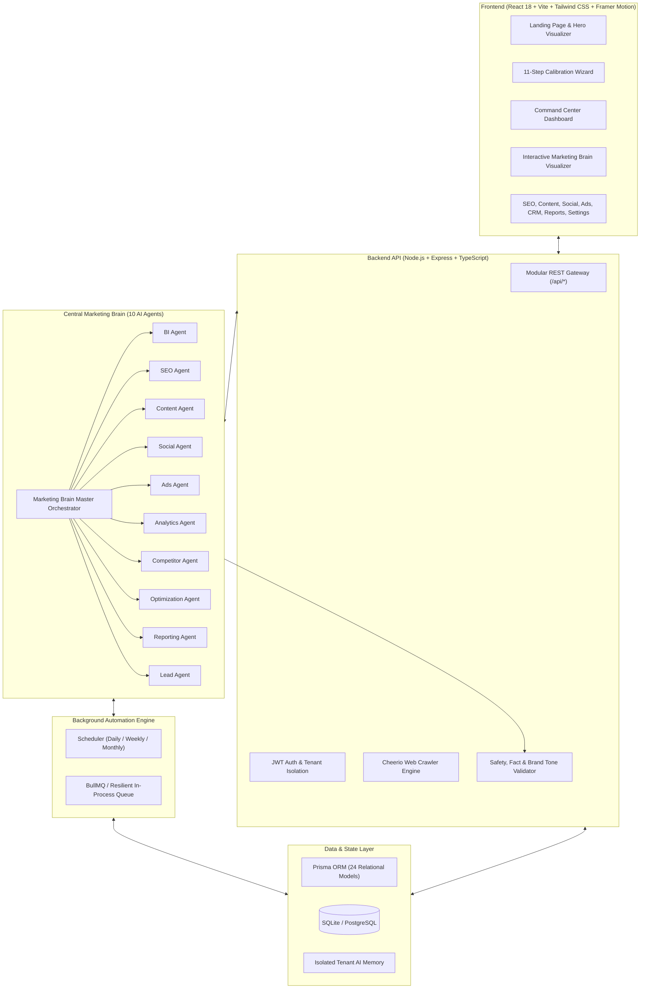

# MarketMind AI - Autonomous AI-Powered Digital Marketing Automation SaaS Platform

> **"Your AI Marketing Team, Working 24/7."**

MarketMind AI is an enterprise-ready, autonomous digital marketing SaaS platform. A business connects their website and marketing accounts once, configures their budget and goals once, and the centralized **Marketing Brain** coordinates 10 specialized AI agents to continuously handle SEO, social media, Google & Meta Ads, content generation, analytics, competitor intelligence, and lead qualification in the background.

---

## 🌟 Key Highlights & Core Capabilities

- **10 Autonomous AI Agents Orchestrated by "Marketing Brain"**:
  1. **Business Intelligence Agent**: Crawls target domain, extracts brand voice, target personas, and USPs.
  2. **SEO Agent**: Technical SEO health audits, keyword clustering across search intents, and local NAP diagnostics.
  3. **Content Agent**: Generates long-form SEO blog posts, landing pages, meta tags, and FAQ schema markup.
  4. **Social Media Agent**: Crafts 30-day cross-platform schedules (LinkedIn, Instagram, X, Facebook, YouTube) and auto-publishes where permitted.
  5. **Ads Agent**: Plans Google Search Ads (responsive ads, negative keywords) and Meta Ads (creatives, lookalikes).
  6. **Analytics Agent**: Synthesizes cross-channel traffic, conversion funnels, and blended ROAS metrics.
  7. **Competitor Agent**: Non-invasive public crawl detecting content gaps, keyword vacuums, and rival vulnerabilities.
  8. **Optimization Agent**: Evaluates algorithmic budget reallocation and bid shifts within strict safety guardrails.
  9. **Reporting Agent**: Compiles standardized 6-part executive briefings with 1-click CSV and print-ready PDF export.
  10. **Lead Agent**: CRM pipeline with automated intent scoring (Hot/Warm/Cold) and personalized follow-up guidance.
- **Autonomous Background Execution**:
  - Continuous 24/7 background scheduler engine running independent of the browser.
  - Periodic SEO crawling, ad bid monitoring, and social queue broadcast.
- **Strict Budget Guardrails & Emergency Stop**:
  - Enforced monthly budgets and daily caps.
  - Budget shifts >20% or live ad launches automatically route to the **Needs Your Approval** center.
  - 1-Click **Emergency Stop** immediately pauses all active campaigns.
- **Honest Integration Architecture**:
  - Live API status indicators for Google Search Console, Google Analytics 4, Google Ads, Meta Ads, and LinkedIn.
  - Unconnected platforms run seamlessly in an isolated **Sandbox Demo Mode**, clearly labeled to prevent confusion.
- **Premium Soft Colorful UI / UX**:
  - Built with Tailwind CSS, Framer Motion, soft pastel gradients (lavender, mint, sky blue, peach, blush), 16–24px rounded corners, glassmorphic elevation, and interactive Recharts data visualizations.

---

## 🏗 System Architecture



---

## 🚀 Quick Start (Local Development)

### 1. Prerequisites
- **Node.js**: v18.0.0 or higher (v22+ recommended)
- **npm**: v9.0.0 or higher

### 2. Clone & Install
```bash
git clone https://github.com/your-org/marketmind-ai.git
cd marketmind-ai
npm install
```

### 3. Initialize Database & Seed Demo Data
```bash
# Push Prisma schema to local SQLite database
npm run db:push

# Seed with verified realistic demo data (NexusFlow AI)
npm run db:seed
```

### 4. Run Development Servers
```bash
# Starts both Express Backend (:5000) and Vite Frontend (:3000) concurrently
npm run dev
```

Open your browser at `http://localhost:3000`.

---

## 🔑 Demo Account Credentials

| Role | Email | Password | Workspace |
| :--- | :--- | :--- | :--- |
| **Super Admin / Founder** | `founder@nexusflow.io` | `password123` | NexusFlow Technologies |
| **Instant 1-Click Access** | Click **"Instant 1-Click Demo Login"** on the Sign In page |

---

## ⚙️ Environment Configuration (`.env`)

Copy `.env.example` to `.env`:

```env
# Server
PORT=5000
NODE_ENV=development
APP_URL=http://localhost:3000

# Database (SQLite; must match the provider in prisma/schema.prisma)
DATABASE_URL="file:./dev.db"

# Authentication
JWT_SECRET=your_super_secret_jwt_key_here
SESSION_SECRET=your_session_secret_key_here

# AI Provider ("auto", "gemini", "openai", "smart-mock")
# If API keys are omitted, MarketMind runs on the Neural Heuristic Engine with zero failure
AI_PROVIDER=auto
GEMINI_API_KEY=
OPENAI_API_KEY=

# Background Queue (Optional: uses high-speed in-process queue if Redis is not set)
REDIS_URL=

# External OAuth Integrations
GOOGLE_CLIENT_ID=
GOOGLE_CLIENT_SECRET=
META_APP_ID=
META_APP_SECRET=
LINKEDIN_CLIENT_ID=
LINKEDIN_CLIENT_SECRET=
```

---

## 🧪 Automated Testing

Run the full end-to-end verification suite covering safety validators, crawler accuracy, agent generation, budget guardrails, and lead scoring:

```bash
npx tsx test/system.test.ts
```

Output:
```
Verification Complete: 22 Passed, 0 Failed
```

---

## 📦 Production Build & Deployment

### Build Client & Server
```bash
npm run build
```

This compiles:
- `dist/server/`: Production CommonJS Node server
- `dist/client/`: Minified, tree-shaken static assets with gzip compression

### Production Start
```bash
npm start
```
The server serves the REST API on `/api/*` and delivers the static React client from `dist/client` for all other routes.

### Docker Deployment
Create a `Dockerfile`:
```dockerfile
FROM node:22-alpine AS builder
WORKDIR /app
COPY package*.json ./
RUN npm ci
COPY . .
RUN npm run db:push && npm run build

FROM node:22-alpine
WORKDIR /app
COPY package*.json ./
RUN npm ci --omit=dev
COPY --from=builder /app/dist ./dist
COPY --from=builder /app/prisma ./prisma
COPY --from=builder /app/dev.db ./dev.db
EXPOSE 5000
CMD ["npm", "start"]
```

---

## 🛡 Security & Compliance

- **Tenant Isolation**: Organizations, AI memory, and credentials strictly segregated by `organizationId`.
- **Encrypted Secrets**: OAuth tokens and API secrets stored encrypted, never exposed to client bundles.
- **Budget Guardrails**: Hard spend caps enforced in software with immediate emergency stop overrides.
- **AI Safety Disclaimer**: Transparency notices on all generated assets with confidence scoring and fact validation checks.

---

## 📌 Roadmap & Future Integrations (TODO)

The following integrations are intentionally deferred and scheduled for future phases as they require separate developer app approvals and elevated enterprise verification:

1. **YouTube Data API v3 & YouTube Shorts Auto-Publisher**:
   - Requires Google Cloud Console verification for `https://www.googleapis.com/auth/youtube.upload` scope and OAuth consent screen brand audit.
   - Will support direct automated upload of generated video assets, title/description tagging, and short-form video distribution.

2. **Google Business Profile (GBP) API**:
   - Requires Google Business Profile API account approval via Google Partner program.
   - Will support local business post broadcasts, review response automation, and local NAP (Name, Address, Phone) citation synchronization.

---

## 📄 License

MIT License &copy; 2026 MarketMind Technologies Inc.
